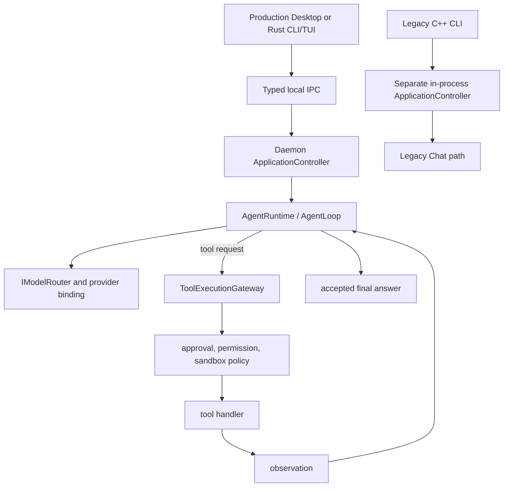

# Agent Runtime

**Status: Implemented; real-model reliability acceptance incomplete.** Agent execution is multi-step and cancellable, but completion and capability availability remain policy- and provider-dependent. Fixture success is not proof of reliable live task completion.

Agent Mode enters through `AgentRuntime`. `LlmAgentRuntime` uses `AgentLoop` for multi-step execution; a tool completion is an observation, not completion of a run. Controlled tasks use the same runtime through `ControlledTaskService`, which owns records, session mapping, and `AgentEvent` projection.

An active run holds one `ModelBinding` resolved through `IModelRouter`. The loop can stream steps and final messages, accepts cancellation, enforces iteration limits, and uses doom-loop detection. Tool arguments are validated against the authoritative `ToolDescriptor` schema before a handler runs. Results are truncated where necessary before returning to the model context.

Natural-language input is never converted into a shell command by heuristic planning. Provider failures, rejected approvals, validation failures, cancellation, and tool failures remain run events or errors; only an accepted final answer completes the run.

## Run budget and observations

`AgentLoop` separates productive tool steps from blocked proposals. The default productive budget is 24 steps; validation failures, unknown tools, and denied calls are counted separately and terminate the run after 6 total or 4 consecutive blocked steps. A productive tool execution resets the consecutive counter, so an early malformed proposal does not decide the rest of the run. A malformed proposal therefore cannot consume the budget reserved for real work, while repeated invalid actions still stop the loop.

Tool output is truncated to a bounded preview (default 16 KiB / 120 lines). The preview reports the full-output path and tells the model to request a narrower range instead of repeating the same call. The context assembler keeps the newest observations intact and compacts older ones head-and-tail, preserving the beginning and the failure tail without unbounded request growth. A deterministic run checkpoint (step counts, recent blockers, and changed resources) is retained separately so compacted observations do not erase the run's progress.

A repeated identical action is never executed again. Read-only repeats and already successful verification commands get one planning repair. A repeated mutation or other non-observation action also gets one bounded repair, but a final answer is not accepted while that repair is unresolved. A repeat of a call whose previous attempt executed and returned a definitive or transient result (NotFound or Timeout) also gets one bounded repair stating that result, so the planner can choose a different action or answer from existing evidence; invalid, unknown, denied or capability-unavailable repeats keep the immediate fail-closed stop. If the planner still cannot choose a different action, the run stops as stuck rather than reporting success.

## Final answers and verification recovery

A verified final answer is published as the model's natural-language response. The evidence-derived projection is a fallback when the answer is empty and a mandatory representation only when the observation scope cannot support an absence conclusion (for example, a directory listing with hidden entries excluded or truncated). Claim, permission, approval, and sandbox checks remain authoritative.

When a final is rejected solely because a read-only verification requirement is missing, `AgentLoop` may recover by running one permitted `read-file`, `git-diff`, or `git-status` step, up to three times. The final is accepted only after the resulting evidence is observed; a receipt-only claim never completes a run on its own.

## Model generation waits

Agent classification and planning add no wall-clock deadline for providers registered as
Local (LM Studio, Ollama, llama.cpp and the local compatible endpoint). The generation
request carries the run's cancellation token and remains interruptible through Stop.
An explicitly configured provider timeout still applies; the default is zero (disabled).
Cloud and unknown providers retain the classification/planning deadlines of 60/120 seconds.
Local planning uses the cancellable non-streaming request contract, rather than claiming
that an unlimited request satisfies the bounded-streaming contract. A classification request
that the provider rejects (for example a small local reasoning model that exhausts its output
budget on hidden reasoning before emitting the JSON) is retried once with the identical
prompt, budget and cancellation token; a second failure reports the run indeterminate.
Output/context admission,
iteration limits, final grounding and tool/approval timeouts remain independent.

## Approval lifetime

A run paused for approval is not an unbounded wait. `AgentRuntime` applies a five-minute approval timeout by default (`setApprovalTimeoutMs`, zero disables it). On expiry the pending plan is explicitly denied, its session grants are cleared, no tool is dispatched, and the run terminates as `Failed` / `ApprovalDenied` with a retryable message. Approving or cancelling invalidates the timer, and a late timer cannot overwrite a newer run generation. The desktop approval dialog still offers immediate Deny, Allow once, and Cancel run; the timeout only prevents a forgotten prompt from leaving the session permanently paused.
