# Architecture

Sentinel is a C++20/Qt 6 modular monolith. Desktop, CLI, daemon, and plugin host are executable surfaces over the `sentinel_core` static library.

```mermaid
flowchart TD
  D[Desktop Qt/QML and view models] --> IPC[Typed local IPC v1]
  A[ApplicationController and core services]
  C[Legacy C++ CLI] --> LC[Separate in-process core composition]
  RC[Rust CLI] --> IPC
  RT[Rust TUI] --> IPC
  IPC --> N
  N[Daemon] --> A
  A --> R[Agent and chat runtime]
  R --> T[Tool registry and gateway]
  R --> P[Provider/model routing]
  A --> S[Settings, sessions, memory, stores]
  T --> X[Plugins, MCP, filesystem, processes]
  P --> X
  S --> O[Qt SQL and platform paths]
```

`apps/sentinel-desktop` owns the Qt/QML shell and bootstrap. QML is presentation; `DesktopShellViewModel` and related view models expose safe state and actions. `apps/sentinel-cli` is a partial, small command dispatcher. `apps/sentinel-daemon` is the headless production runtime authority for Desktop and Rust CLI/TUI clients: it composes existing core services through the same builder and exposes versioned local IPC for sessions, Chat, Agent, approvals and cancellation. Production Desktop is a daemon-backed IPC client with separate local presentation preferences. Its Quick Panel shares the existing DesktopRuntimeClient; NativeCompanionAdapter owns platform activation, tray, shortcuts and lifecycle. Desktop can launch a detached daemon through `ApplicationBootstrapper::ensureBackgroundDaemon` when needed; safe mode and `--no-daemon-start` suppress this attempt. Process launching does not transfer execution ownership to Desktop: it constructs no in-process ApplicationController fallback. Rust clients require an externally started daemon. The legacy C++ CLI retains a separate in-process composition path. See [daemon development](DAEMON.md) and [IPC](../interfaces/IPC.md). `apps/sentinel-plugin-host` supports the experimental plugin-host protocol.

`core/` owns the shared application controller and domain services. Agent work flows through `AgentRuntime`/`AgentLoop`, with `LlmAgentRuntime` supplying LLM step decisions and `ControlledTaskService` projecting controlled tasks through the same runtime; provider behavior through `IChatProvider` and `IModelRouter`; tools through `IToolRegistry`, `ToolDescriptor`, and `ToolExecutionGateway`. `IFileSystemService` and `ProcessExecutor` isolate system-facing tools. Platform functionality belongs behind interfaces such as `IPathProvider`, `IPlatformService`, and `ISystemIntegrationService`.

Persistence remains split: settings use `ISettingsStore`; memory uses `IMemoryStore`; history and conversations use their own stores; permission grants and agent runs have separate SQLite stores. Qt SQL is the SQLite path. Core should not depend on QML presentation or platform-only behavior.

Scoped memory uses the existing `IMemoryStore` owner and memory database. Schema v4 adds
`scoped_memory_entries` for session, project and explicitly included personal records; the old
`memory_entries` table remains unclassified Legacy data with its original keys/values/IDs.
Legacy data is excluded from automatic scoped retrieval. Session records also bind their workspace
so selecting another workspace cannot expose the same conversation's previous project memory.
ApplicationController resolves scope from the active conversation and selected existing workspace;
ChatModeService snapshots scoped data before inference. AgentLoop/ContextEngine and memory-search
use runtime-owned session/workspace identity, including the gateway's sealed invocation session.
Stable UUIDs, UTC metadata, typed provenance and bounded source references survive retrieval;
generated/inferred/unknown content remains untrusted data. Personal inclusion is off in production
composition until an explicit sharing policy is supplied. Existing JSON memory backup is refused
when scoped rows exist, avoiding lossy export or rollback; P8-03 supplies scoped management/correction/deletion UI and versioned scope archives.
Schema 5 retains Legacy UUIDs and correction receipts; combined legacy backup stays blocked
for all managed records. P8-04 schema 6 adds transactional per-record scoped FTS5 triggers
and explicit bounded repair. Shared lexical ranking selects authorized candidates before
ContextBudgetManager admission, with explicit index fallback and unavailable semantic scores. See [P8-01](../audits/P8_01_SCOPED_MEMORY_IMPLEMENTATION_RESULT.md).

Provider-bound Chat and Agent requests pass through `ContextBudgetManager` before dispatch.
It consumes the already resolved `ModelBinding`, reserves output, measures escaped text plus
actual tool/structured-schema and continuation contracts with explicit estimate uncertainty,
and selects complete optional context units deterministically. Chat keeps complete recent turns
and scoped memory records; persisted generated summaries do not replace verified transcript.
Agent admission includes its rendered planner/security instructions, task, workspace/requirements,
execution evidence and native call/result continuation. Necessary evidence that cannot fit causes
an explicit refusal rather than an accepted final answer. ContextEngine's bounded source discovery
is candidate preparation, not final request admission. The 8192 unknown-capacity fallback is a
policy ceiling, not a claim of model capacity; actual token counts remain unknown. Image-bearing
requests explicitly refuse while no trustworthy provider image-token bound exists. Diagnostics
contain counts/status/estimates only. See [P8-02](../audits/P8_02_CONTEXT_BUDGET_MANAGER_RESULT.md)
for behavior changes and compatibility limits.

The concurrency model uses Qt signals/events for UI and provider integration; agent execution scheduling and loop events keep active work observable and cancellable. See [Agent Runtime](../concepts/AGENT_RUNTIME.md) for run semantics. These components are implemented; reliable real-model task completion remains unaccepted.

Built-in provider identity and static registration metadata live in the immutable `ProviderRegistry`
descriptor table. ModelService composes its existing runtime factories from those descriptors and
continues to own selection, binding, endpoint/credential resolution, health and capability merging.
Discovery dispatch consults the same descriptors; transport, catalog parsing and cancellation remain
in their existing owners. Provider defaults carry `ProviderDefault` provenance and are not live
model verification. See the [P2-M05 audit](../audits/P2_M05_PROVIDER_REGISTRY_DISCOVERY_RESULT.md)
for facade compatibility and discovery limitations. The shared non-Ollama endpoint adapter now
lives in `core/provider/SelectedEndpointChatProvider`, composed through a narrow factory returning
`IChatProvider`. It owns request execution and protocol-specific continuation/response handling;
ModelService retains selection, binding, configuration, health and capability orchestration.
It reuses the existing LocalInference transport and protocol modules rather than creating vendor
HTTP engines. OpenAI-compatible native request/continuation serialization, shared function-name/tool
schema conversion, first-choice/usage normalization and object-only JSON decoding live in the
existing OpenAiCompatibleProtocol module. The adapter retains capability/registration policy,
request budgets, transport execution, lifecycle/error mapping and native Claude/Gemini orchestration. See the [P2-M06 audit](../audits/P2_M06_SHARED_ENDPOINT_ADAPTER_EXTRACTION_RESULT.md).

Hardware capability facts and model-fit estimates exist, but a continuous CPU/RAM/GPU pressure-driven adaptive resource policy is not implemented. Linux global Quick Panel shortcuts use the session-bus GlobalShortcuts portal when the backend confirms a binding; unavailable portals and refused bindings remain unavailable. Native KDE/Wayland registration and focus acceptance remain unverified (see the [P6-04 report](../audits/P6_04_KDE_WAYLAND_NATIVE_INTEGRATION_RESULT.md)). Daemon clipboard tools require a GUI and are unavailable in the headless process; Linux application launching is explicitly unsupported. Native platform behavior remains subject to acceptance, including Rust Windows named-pipe transport, which is not implemented. Public distribution blockers remain in the [SEC-P1 register](SEC_P1_4_GITHUB_HARDENING_REPORT.md#5-consolidated-blocker-register).

P8-05 adds schema 7's ordered scope archive index, worker-owned forward-only
SQLite snapshot reads, bounded v2 chunk archives and atomic source/FTS restores.
`MemoryArchiveJobs` owns opaque context-bound private staging jobs; the native
`DesktopBackupHelper` transfers bounded chunks through existing typed desktop
management IPC. Selected paths never reach daemon IPC. Correction history is
non-destructively bounded at 256 with paged inspection. Combined managed-memory
backup remains blocked without coordinated cross-domain recovery; see
[Memory](../concepts/MEMORY.md) for limits and cancellation semantics.

P8-06 storage inspection found no shared write barrier, stable application-profile
identity or durable multi-owner restore journal. `BackupService` now explicitly
reports coordinated backup/recovery as Blocked and refuses multi-domain legacy
export/import before mutation. Settings exposes that capability through the existing
typed daemon/Desktop action; the Desktop offers one portable domain at a time and
a Cancel-focused confirmation. The internal BackupRecoveryJournal now persists bounded preimages and verified
state receipts through Qt SQL, with explicit Unix file-identity/durability checks
and real process-interruption tests. It is not bound to a live owner quiescence or
replacement/reinitialization protocol; no combined format or crash-safe application
restore is enabled. See [P8-06](../audits/P8_06_COORDINATED_BACKUP_RECOVERY_RESULT.md).

### Storage admission foundation (P8-06A)

`ApplicationControllerBuilder::withStandardDefaults` creates one process-local
`StorageAdmission` shared by AppSettings, its memory/conversation/history SQLite owners,
Agent run and permission-grant stores, and memory archive workers. Writers hold a move-only lease before schema or transaction mutation.
Store generations are immutable; archive workers inherit the originating store's
generation rather than refreshing authority when a job runs.

This is partial coverage. The live application coordinator refuses maintenance
preparation with `Unsupported` before changing state: independent settings/projection writers, additional side-effect owners,
asynchronous work outside the enrolled lifetimes, and independent processes are
not collectively enrolled. `prepareApplication()` is always `Unsupported`.
The explicit leaf-store scope supports bounded drain/maintenance tests and future
trusted orchestration; it must not be substituted for the live application scope.
No IPC/model maintenance command or live journal replacement is enabled. See
`docs/audits/P8_06A_STORAGE_ADMISSION_QUIESCENCE_RESULT.md` for coverage and restrictions.

P8-06A.1 enrolls AppSettings before standard runtime composition, including settings,
workspace/catalog/profile setters, migration writes and portable basic-settings imports.
ISettingsStore's optional atomic applyChanges contract publishes workspace catalog,
selection and repaired default in one JsonSettingsStore/QSaveFile transaction; unsupported
owners refuse without successive setter fallback. Desktop submits runtime changes as
Pending and keeps authoritative projected values until the daemon reply. Transient
configuration/discovery readers disable persistence. Legacy config CLI and independent
presentation/platform preference owners still prevent profile-wide coordination. See
[settings/workspace coordination](../audits/P8_06A1_SETTINGS_WORKSPACE_COORDINATION_RESULT.md).

P8-06A.2 adds immutable-generation admission to SQLiteChatHistoryStore,
SQLiteAgentRunStore and SQLitePermissionGrantStore, including initialization and
retention. Agent evidence must persist before tool dispatch and accepted completion;
a failed audit write stops further dispatch and reports inspectable failure without
replaying side effects. Failed persistent revocation restricts the permission service.
Chat, local inference/summary, daemon title workers and optional background-job metadata
retain their originating authority through queued completion. Read-only Agent/grant
connections cannot recreate missing database files. Application-wide preparation remains
Unsupported and combined backup/restore remains Blocked; see
[storage asynchronous coordination](../audits/P8_06A2_STORAGE_ASYNC_COORDINATION_RESULT.md)
for the uncovered writer/process inventory and validation limits.
